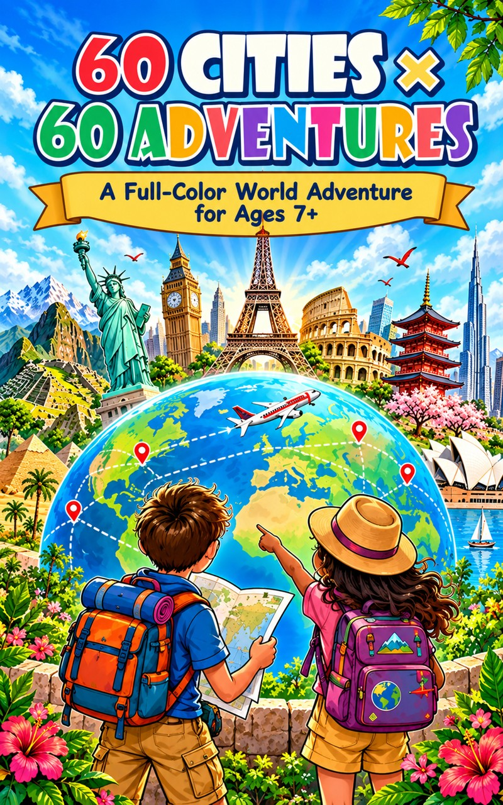

# 60 Cities x 60 Adventures

**A full-color world adventure for ages 7+ by Brandon Hui.**

A picture book project that introduces 60 cities through colorful scenes, city facts, look-and-find activities, and quick quizzes. Designed for children ages 7 and up to explore with parents, caregivers, and educators.

**[View the Kindle edition on Amazon](https://www.amazon.com/dp/B0HM2XQ5YC)** · **[Preview the three-city sample](60-Cities-60-Adventures-Sample.pdf)**

## Inside the sample

Visit **New York City, Tokyo, and London**. The nine-page PDF includes the cover, a sample introduction, two original interior pages per city, and the corresponding quiz answers.

## Author direction and AI-assisted production

I developed the book concept, educational framing, and artwork concepts. I reviewed the material, made editorial changes, directed revisions, and retained final creative and editorial control.

ChatGPT Work supported a semi-automated creation and editing workflow. A production tracker recorded city content, artwork plans, revisions, page assembly, and review checks, including consistency between activities and quiz answers.

Illustrations were generated with AI tools and reviewed under my direction. This project informed the production workflow I later refined for *My First STEM Coloring Book*.

This repository shares a selected preview. The full manuscript, editable production files, and internal tracker are not included.

## About the author

Brandon Hui writes children’s books as a hobby and designs instructions for custom GPTs.

## Kindle edition

Amazon lists *60 Cities x 60 Adventures: The Kindle Edition* by Brandon Hui, with a release date of **October 9, 2026**. ASIN: **B0HM2XQ5YC**. See the Amazon page for current availability and pricing.

## Copyright and sample use

Copyright © 2026 Brandon Hui. All rights reserved.

You may read, download, and print the sample for personal, noncommercial use at home or in a classroom. Please share this repository’s link rather than redistributing the files. Do not resell, republish, or reuse the illustrations without written permission. See [COPYRIGHT.md](COPYRIGHT.md) for details.
